# llm-evalboard

<p align="center">
  <strong>Statistically Honest LLM Evaluation Framework & Dashboard</strong><br>
  <em>Answers one question reliably: "Is this prompt or model change a real improvement, or just noise?"</em>
</p>

<p align="center">
  
  
  
  
  
  
</p>

---

## The Problem: Why Conventional LLM Evals Fail

When evaluating LLMs, prompt engineers and machine learning teams routinely fall into three statistical traps:

1. **The Flakiness Illusion:** Running a stochastic model once ($temperature > 0$) and seeing an accuracy shift from 82% to 85% is frequently pure random noise. In single-run benchmarks, a change that "passes" is often just a lucky sampling run (**a False Pass**).
2. **The Missing Equivalence Margin:** In real applications, a 0.5% shift is rarely meaningful. Without an explicit indifference band ($\pm\delta$), teams waste weeks bikeshedding trivial variations or deploying changes that perform worse in production.
3. **Uncalibrated Judges:** Using GPT-4 or Claude 3.5 to grade outputs without measuring inter-annotator agreement against human ground truth produces blind spots, self-enhancement bias, and severe position bias (favoring the first answer presented).

**`llm-evalboard` fixes this by making statistics the product.**

---

## Feature Comparison

| Capability | llm-evalboard | Promptfoo | DeepEval | LangSmith |
| :--- | :---: | :---: | :---: | :---: |
| **Paired Cluster Bootstrap CIs** | **Yes (95% CI)** | No | No | No |
| **Equivalence Margin Testing ($\pm\delta$)** | **Yes** | No | No | No |
| **4-Way Verdicts (`BETTER`, `WORSE`, `NO DIFF`, `INCONCLUSIVE`)** | **Yes** | No (Pass/Fail) | No (Pass/Fail) | No (Pass/Fail) |
| **False Pass Detection (Shadow Mode)** | **Yes** | No | No | No |
| **Content-Addressed SHA-256 Immutability & Caching** | **Yes (\$0 on re-run)** | Query-based | No | Run-based |
| **Judge Calibration (Weighted Cohen's $\kappa$)** | **Yes + Trust Badges**| No | No | Custom |
| **Position-Bias Mitigation ($A/B \leftrightarrow B/A$)** | **Automatic** | Manual | No | No |
| **Production Flywheel (PII Scrub + Dedup + Promotion)** | **Built-in** | No | No | Manual |
| **Red-Teaming Wilson Score ASR** | **OWASP Top 10** | Plugin | Plugin | No |
| **PR Comment Bot with ASCII Forest Plots** | **Built-in** | Web view | No | Web view |
| **Native Promptfoo Interoperability** | **Drop-in Import/Export** | N/A | No | No |

---

## 3-Step Quickstart

### 1. Install & Build

```bash
# Clone the repository
git clone https://github.com/llm-evalboard/llm-evalboard.git
cd llm-evalboard

# Install dependencies and build monorepo packages
pnpm install
pnpm build
```

### 2. Define Your Evaluation Suite (`evalboard.yaml`)

```yaml
name: Customer Support QA Suite
delta: 0.03 # Equivalence margin (3%)

prompts:
  - id: baseline-prompt
    path: ./prompts/support-v1.txt
  - id: candidate-prompt
    path: ./prompts/support-v2.txt

dataset:
  path: ./datasets/support-tickets.jsonl

providers:
  - id: baseline-model
    provider: anthropic
    model: claude-3-5-haiku-20241022
  - id: candidate-model
    provider: anthropic
    model: claude-3-5-sonnet-20241022

graders:
  - id: json-validity
    type: is-json
    weight: 0.3
  - id: response-quality
    type: llm-rubric
    config:
      rubric: "Rate response professionalism, clarity, and conciseness on a scale of 1 to 5."
      model: claude-3-5-sonnet-20241022
    weight: 0.7
```

### 3. Run with Stochastic Repeats

```bash
evalboard run --config evalboard.yaml --repeats 3
```

Compare runs directly in your terminal:
```bash
evalboard compare <baseline-run-id> <candidate-run-id>
```

Or launch the visual Next.js dashboard:
```bash
docker compose up -d db
pnpm --filter @evalboard/web dev
# Open http://localhost:3000
```

---

## The 4-Way Statistical Verdict

Every evaluation comparison outputs a 4-way verdict based on the 95% bootstrap confidence interval $[L, U]$ of the paired difference $\Delta = \text{Candidate} - \text{Baseline}$ against the equivalence margin $[-\delta, +\delta]$:

```text
Equivalence Band (±δ): [-0.030, +0.030]
Point Estimate (d):     +0.0850 (95% CI: [+0.0320, +0.1380])

Scale:    -0.20      -0.10      +0.00      +0.10      +0.20
Axis:    |---------|---------|---------|---------|
delta:                       |                      (±0.030)
CI:                                [---•---]        (d = +0.0850)
```

- 🟢 **`BETTER`**: Lower bound $L > 0$ and point estimate $d \ge +\delta$. The candidate is statistically superior beyond practical indifference. **Safe to ship.**
- 🔴 **`WORSE`**: Upper bound $U < 0$ and point estimate $d \le -\delta$. Statistically proven regression. **Merge blocked.**
- 🔵 **`NO MEANINGFUL DIFFERENCE`**: Entire interval $[L, U] \subseteq [-\delta, +\delta]$. The difference is practically indistinguishable from zero. **Ship the cheaper/faster model.**
- 🟡 **`INCONCLUSIVE`**: Interval spans across the tolerance boundary. Variance is too high or sample size is too small. **Evalboard outputs the exact number of additional test cases needed to achieve 80% power.**

---

## System Architecture

```mermaid
flowchart LR
    subgraph Inputs["1. Sources & Inputs"]
        CFG["evalboard.yaml<br/>promptfooconfig.yaml"]
        DATA["Datasets & Prompts"]
        TRACES["Production Traces"]
    end

    subgraph Core["2. Core Engine"]
        RUNNER["Runner & Matrix"]
        STATS["Paired Bootstrap<br/>& Stats Engine"]
        JUDGE["Calibrated Judges<br/>& Graders"]
        FLYWHEEL["PII Scrub &<br/>Flywheel Promotion"]
        REDTEAM["OWASP Red-Team<br/>Wilson ASR"]
    end

    subgraph CacheDB["3. Content-Addressed Storage"]
        DISK[(".cache/evalboard<br/>SHA-256 Cache")]
        POSTGRES[("PostgreSQL<br/>Drizzle Repositories")]
    end

    subgraph Interfaces["4. Interfaces & Delivery"]
        CLI["evalboard CLI"]
        WEB["Next.js 15 Dashboard"]
        ACTION["GitHub Action CI Gate"]
        OTEL["OTel & Langfuse"]
    end

    Inputs --> Core
    Core --> CacheDB
    CacheDB --> Interfaces
```



---

## GitHub Action CI & Sticky PR Comment Bot

Enforce statistical merge gating in your pull requests with zero notification noise:

```yaml
# .github/workflows/eval.yml
name: LLM Evaluation Gate
on:
  pull_request:
    paths: ['prompts/**', 'evalboard.yaml', 'datasets/**']

jobs:
  evaluate:
    runs-on: ubuntu-latest
    steps:
      - uses: actions/checkout@v4
      - uses: actions/setup-node@v4
        with:
          node-version: 22
      - uses: ./action
        with:
          config: evalboard.yaml
          github-token: ${{ secrets.GITHUB_TOKEN }}
          delta: 0.03
          repeats: 3
          fail-on-regression: true
          fail-on-inconclusive: false
        env:
          ANTHROPIC_API_KEY: ${{ secrets.ANTHROPIC_API_KEY }}
```

The GitHub Action posts and updates an accessible, sticky comment on your PR with:
- Accessible WCAG status badges (`[+] BETTER`, `[-] WORSE`, `[=] NO MEANINGFUL DIFFERENCE`, `[?] INCONCLUSIVE`).
- ASCII Forest Plot illustrating the 95% confidence interval against the equivalence band.
- Core Metrics comparison table (Score, Latency, Token Cost in USD).
- Slice Analysis breakdown across prompt tags and input lengths.
- Sample size recommendations when inconclusive.

---

## CLI Command Cheat Sheet

| Command | Usage | Description |
| :--- | :--- | :--- |
| **`evalboard run`** | `evalboard run -c evalboard.yaml -r 3` | Runs evaluation matrix with stochastic repeats and SHA-256 caching. |
| **`evalboard compare`** | `evalboard compare <run1> <run2> -d 0.03` | Compares two runs statistically with ASCII forest plots and slice analysis. |
| **`evalboard prompt diff`** | `evalboard prompt diff p1.txt p2.txt` | Shows semantic and unified diffs between prompt versions. |
| **`evalboard dataset check`** | `evalboard dataset check data.jsonl` | Audits dataset quality, missing variables, duplicates, and token length distribution. |
| **`evalboard judge calibrate`** | `evalboard judge calibrate -j judge.yaml -g gold.jsonl` | Measures judge agreement against human ground truth using weighted Cohen's $\kappa$. |
| **`evalboard redteam run`** | `evalboard redteam run -c redteam.yaml` | Executes adversarial security probes across OWASP Top 10 with Wilson score ASR. |
| **`evalboard flywheel ingest`** | `evalboard flywheel ingest traces.jsonl` | Ingests production traces, scrubs PII (emails, cards, keys), and deduplicates cases. |
| **`evalboard promptfoo shadow`**| `evalboard promptfoo shadow config.yaml -r 5` | Runs Promptfoo config in shadow mode to detect flaky "False Passes". |
| **`evalboard promptfoo import`**| `evalboard promptfoo import config.yaml -o evalboard.yaml`| Imports Promptfoo YAML into content-addressed Evalboard format. |
| **`evalboard promptfoo export`**| `evalboard promptfoo export evalboard.yaml -o config.yaml`| Exports Evalboard configuration back to standard Promptfoo YAML. |

---

## Documentation & Learning Resources

- **[Getting Started Guide](./docs/getting-started.md):** Installation, configuration, and running your first evaluation.
- **[Migrating from Promptfoo](./docs/migration/from-promptfoo.md):** Drop-in compatibility, Shadow Runner, assertion mapping matrix, and diagnostic warnings.
- **[Continuous Evaluation with GitHub Actions](./docs/ci-cd-github-actions.md):** Setting up merge gating, PR sticky comment bot, OpenTelemetry, and Langfuse.
- **[Statistical Methodology](./docs/methodology.md):** Cluster bootstrap formulas, equivalence testing, Cohen's $d_z$, Wilson score intervals, and power analysis.
- **[Architecture Overview](./docs/architecture-overview.md):** Deep dive into content-addressed immutability, judge calibration, production flywheel, and red-teaming.
- **[Architectural Decision Records (ADRs)](./docs/decisions/README.md):** Detailed technical justifications for every major design choice (ADR-001 through ADR-009).

---

## Monorepo Packages

```text
llm-evalboard/
├── packages/
│   ├── stats/           # Bootstrap, paired tests, Cohen's d_z, power analysis, Pareto
│   ├── core/            # Domain models, canonical hashing, runner engine, diffing
│   ├── providers/       # Anthropic, OpenAI-compatible, Mock, rate limiting, disk cache
│   ├── graders/         # Deterministic graders, LLM-as-a-judge, Cohen's kappa calibration
│   ├── db/              # PostgreSQL Drizzle ORM schema, repositories, immutability
│   ├── flywheel/        # Trace ingestion, multi-pattern PII scrubbing, dedup, promotion
│   ├── redteam/         # OWASP Top 10 probes, Wilson score ASR, adaptive attacker loop
│   ├── promptfoo-compat/# Native parser, shadow runner, bidirectional import/export
│   └── cli/             # 'evalboard' CLI command
├── apps/
│   ├── web/             # Next.js 15 dashboard, compare view, Recharts Pareto plot
│   └── worker/          # pg-boss background job consumer
├── action/              # GitHub Action CI runner, merge gating, PR comment bot
├── conformance/         # SciPy & scikit-learn statistical reference test vectors
└── docs/                # Guides, methodology, and architectural decision records
```

---

## License

Distributed under the [MIT](LICENSE) License.
