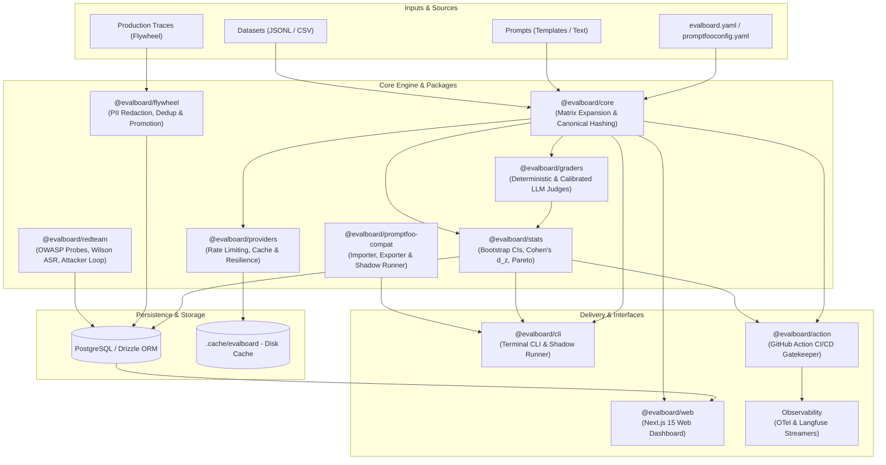

# Architecture Overview

`llm-evalboard` is engineered from the ground up to eliminate subjectivity, flakiness, and ungrounded claims in LLM evaluation. This document describes the system architecture, core design principles, and module boundaries.

---

## 1. Core Architectural Principles

1. **Statistics is the Product:**
   Evaluation without uncertainty quantification is just noise. Every comparison calculates:
   - Paired differences across identical inputs and stochastic repeats ($R \ge 3$).
   - Cluster bootstrap 95% confidence intervals $[L, U]$.
   - Standardized effect sizes (Cohen's $d_z$).
   - 4-way actionable verdicts: `BETTER`, `WORSE`, `NO MEANINGFUL DIFFERENCE`, or `INCONCLUSIVE`.
2. **Content-Addressed Immutability:**
   Every prompt template, dataset row, grader configuration, and evaluation run is identified by the SHA-256 hash of its canonical JSON representation. Unchanged inputs are never recomputed, saving hundreds or thousands of dollars in LLM API calls.
3. **Calibrated Judges:**
   LLM-as-a-judge outputs cannot be blindly trusted. The system mitigates position bias through automatic $A/B \leftrightarrow B/A$ swapping and computes inter-annotator agreement against human ground truth using **weighted Cohen's $\kappa$**, surfacing visible trust badges throughout the UI and CLI.
4. **The Production Flywheel:**
   Evaluation suites should not remain static. Production traces with negative feedback or low confidence are ingested, scrubbed of PII (emails, phone numbers, API keys, JWTs, credit cards, IP addresses), deduplicated, synthetically varied, and promoted directly into regression test suites.
5. **Security & Red-Teaming as First-Class Citizens:**
   Security probes are treated as test suites. Attack Success Rate (ASR) is calculated using Wilson score confidence intervals across the OWASP Top 10 for LLMs.
6. **WCAG AA Accessible by Default:**
   Visual indicators never rely on colour alone. Every alert, badge, and chart features distinctive icons, contrasting borders, and unambiguous text labels.

---

## 2. High-Level Architecture Diagram

---

## 3. Package & Monorepo Structure

The monorepo is structured into decoupled, single-responsibility TypeScript packages managed by `pnpm`:

| Package / App | Location | Purpose |
| :--- | :--- | :--- |
| **`@evalboard/stats`** | `packages/stats` | Pure mathematical package implementing cluster bootstrap resampling, paired difference tests, equivalence margins ($\pm\delta$), Cohen's $d_z$, power analysis, and Pareto frontier extraction under uncertainty. Zero external runtime dependencies. |
| **`@evalboard/core`** | `packages/core` | Domain models, canonical JSON serialization, SHA-256 content hashing, suite matrix expansion, execution runner, and prompt/dataset diffing. |
| **`@evalboard/providers`** | `packages/providers` | Unified provider interface for Anthropic, OpenAI-compatible APIs (Ollama, vLLM, OpenRouter), and deterministic mock providers. Includes content-addressed disk caching, token-bucket rate limiting, exponential backoff, and dynamic pricing lookup. |
| **`@evalboard/graders`** | `packages/graders` | Deterministic graders (`exact-match`, `contains`, `regex`, `json-schema`, `is-json`, `similarity`, `performance`), LLM-as-a-judge with position-swap bias mitigation, judge calibration engine (weighted Cohen's $\kappa$), and custom grader registry. |
| **`@evalboard/db`** | `packages/db` | PostgreSQL schema defined with Drizzle ORM, content-addressed repositories, immutability assertions, and migrations. |
| **`@evalboard/flywheel`** | `packages/flywheel` | Production trace ingestion, multi-pattern PII scrubbing (emails, credit cards via Luhn, API keys, high-entropy tokens), MinHash/Jaccard deduplication, synthetic variation generation, and suite promotion. |
| **`@evalboard/redteam`** | `packages/redteam` | Security red-teaming engine covering the OWASP Top 10 for LLMs. Multi-turn adaptive attacker loop and Attack Success Rate (ASR) scoring with Wilson score 95% confidence intervals. |
| **`@evalboard/promptfoo-compat`** | `packages/promptfoo-compat` | Bidirectional Promptfoo interoperability. Native schema parser, assertion mapping matrix, diagnostic warnings, exporter, and the **Shadow Runner** with False Pass detection. |
| **`@evalboard/cli`** | `packages/cli` | The `evalboard` command line interface powered by Commander.js. |
| **`@evalboard/web`** | `apps/web` | Next.js 15 web dashboard with Server Components, Tailwind CSS, Recharts Pareto plot, slice drilldowns, and WCAG AA accessibility. |
| **`@evalboard/worker`** | `apps/worker` | Background queue consumer powered by `pg-boss` for asynchronous evaluation runs and scheduled jobs. |
| **`@evalboard/action`** | `action` | Bundled GitHub Action providing statistical merge gating, PR sticky comment bot with ASCII forest plots, and OpenTelemetry / Langfuse export. |

---

## 4. Deep Dive: Key Architectural Subsystems

### 4.1 Content-Addressed Immutability & Caching
Reproducibility requires that identical inputs produce identical identifiers. 
- Prompt templates are parsed into a canonical AST and hashed with SHA-256 (`h_prompt = sha256(canonical_json(prompt))`).
- Datasets are sorted by case identifier, normalized, and hashed (`h_dataset = sha256(canonical_json(cases))`).
- Every evaluation cell represents a specific tuple:
  $$\text{CellKey} = \text{sha256}(h_{\text{prompt}} + h_{\text{dataset\_case}} + h_{\text{provider}} + \text{seed})$$
- When `evalboard run` executes, it checks the persistent disk cache and database for $\text{CellKey}$. If a match exists, the cached result is used immediately, guaranteeing **zero redundant provider expenditure**.

### 4.2 The Statistical Engine
Traditional evaluation treats each test case as an independent binary pass/fail, ignoring covariance between baseline and candidate variants on the same input.

`llm-evalboard` uses **paired cluster bootstrap resampling**:
1. For each test case $i \in \{1, \dots, N\}$, the paired difference between candidate and baseline across repeats is calculated:
   $$\Delta_i = \bar{X}_{\text{candidate}, i} - \bar{X}_{\text{baseline}, i}$$
2. $B = 2{,}000$ bootstrap replicates are sampled with replacement from the observed clusters $\{\Delta_i\}$.
3. The 95% confidence interval $[L, U]$ is extracted using the percentile bootstrap method.
4. Standardized effect size is computed via Cohen's $d_z$:
   $$d_z = \frac{\bar{\Delta}}{s_{\Delta}}$$
5. The 4-way verdict is evaluated against the equivalence band $[-\delta, +\delta]$:
   - **`BETTER`**: $L > 0$ and $\bar{\Delta} \ge +\delta$
   - **`WORSE`**: $U < 0$ and $\bar{\Delta} \le -\delta$
   - **`NO MEANINGFUL DIFFERENCE`**: $[L, U] \subseteq [-\delta, +\delta]$
   - **`INCONCLUSIVE`**: CI crosses the boundaries of equivalence.

### 4.3 LLM-as-a-Judge Calibration & Bias Mitigation
LLM judges suffer from significant systematic biases:
- **Position Bias:** Judges heavily favor the first option presented ($A$ over $B$). `llm-evalboard` evaluates every pairwise comparison twice in parallel: once as $(A, B)$ and once as $(B, A)$. Inconsistent verdicts are flagged and downgraded.
- **Inter-Annotator Agreement (Calibration Engine):** Before trusting an LLM judge, users calibrate it against a gold-standard dataset labeled by humans. The engine computes **weighted Cohen's $\kappa$**:
  $$\kappa_w = 1 - \frac{\sum w_{ij} O_{ij}}{\sum w_{ij} E_{ij}}$$
  Based on $\kappa$, judges receive a trust rating:
  - $\kappa \ge 0.70$: **`TRUSTED`** (Emerald badge)
  - $0.40 \le \kappa < 0.70$: **`USE WITH CAUTION`** (Amber badge)
  - $\kappa < 0.40$: **`NOT TRUSTED`** (Rose badge)
  - Uncalibrated: **`UNCALIBRATED`** (Slate badge)

### 4.4 Production-to-Test Flywheel
The flywheel bridges production observability and regression testing:
1. **Ingestion:** Captures production traces with user feedback or guardrail violations.
2. **PII Scrubbing:** Runs multi-stage deterministic redaction:
   - Regex patterns for emails, phone numbers, IP addresses (IPv4 & IPv6), bearer tokens, AWS/GitHub API keys.
   - Algorithmic verification: Luhn algorithm check for credit cards; Shannon entropy analysis for high-entropy secrets.
3. **Deduplication:** Uses Jaccard similarity and MinHash signatures to cluster duplicate production failures, avoiding suite bloat.
4. **Synthetic Variation:** Generates linguistic variations of edge cases to test boundary conditions.
5. **Promotion:** Promotes vetted cases into version-controlled JSONL test suites with content-addressed tracking.

### 4.5 Security Red-Teaming Module
Security evaluations are executed systematically against the **OWASP Top 10 for LLMs**:
- Probes cover Prompt Injection, Insecure Output Handling, Sensitive Information Disclosure, Supply Chain Vulnerabilities, and Overreliance.
- **Adaptive Attacker Loop:** Implements multi-turn jailbreaking strategies (roleplay, hypotheticals, prefix injection, refusal suppression).
- **Wilson Score Interval:** Measures Attack Success Rate (ASR) with asymmetric confidence intervals suitable for small sample sizes or low failure probabilities.

---

## 5. Architectural Decision Records (ADRs)

Key architectural decisions are documented in detail within `docs/decisions/`:

- [ADR-001: Technology Stack and Monorepo Tooling](./decisions/ADR-001-stack-and-tooling.md)
- [ADR-002: Promptfoo Relationship and Compatibility Philosophy](./decisions/ADR-002-promptfoo-relationship.md)
- [ADR-003: Content-Addressed Immutability and Caching](./decisions/ADR-003-content-addressed-immutability.md)
- [ADR-004: Pareto Frontier Identification under Statistical Uncertainty](./decisions/ADR-004-pareto-frontier-under-uncertainty.md)
- [ADR-005: Web Dashboard Authentication Strategy](./decisions/ADR-005-dashboard-auth-strategy.md)
- [ADR-006: Production Flywheel and Trace Promotion Architecture](./decisions/ADR-006-flywheel-and-trace-promotion.md)
- [ADR-007: Security Red-Teaming Taxonomy and Scoring](./decisions/ADR-007-security-red-teaming-taxonomy.md)
- [ADR-008: Promptfoo Migration and Shadow Execution Strategy](./decisions/ADR-008-promptfoo-migration-and-compatibility.md)
- [ADR-009: CI Merge Gating and Observability Integrations](./decisions/ADR-009-ci-merge-gating-and-observability.md)
